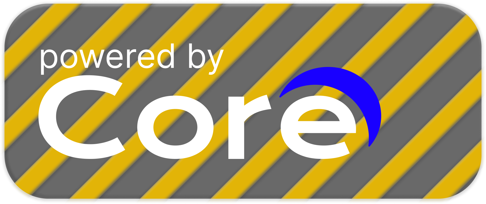
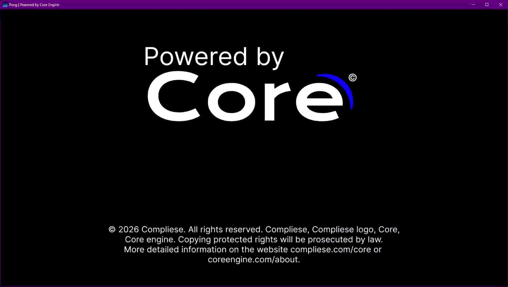

# CoreEngine


**CoreEngine** is a lightweight, custom 2D/3D game engine built from scratch in modern **C++20** and **OpenGL 3.3 Core Profile**. Designed from first principles, the engine focuses on clean architectural boundaries, zero-overhead abstractions, and direct hardware interaction.

---



## Key Architecture & Features

- **Decoupled Engine-Game Architecture:**
  - `CoreEngine` compiles as an independent Static Library (`.lib`).
  - Game client projects (such as `Pong.exe`) interact strictly via the public `api/` layer.
- **Application Lifecycle & Event Hooks:**
  - Centralized `Application` orchestrator managing window creation, runtime state, and clean shutdown.
  - Frame-rate independent physics powered by high-precision Delta Time calculation (`dt`).
  - Decoupled game loop execution via functional callbacks (`std::function`).
- **Low-Level Graphics Pipeline:**
  - Modern OpenGL 3.3 Core Profile implementation.
  - Dedicated dynamic quad rendering pipeline utilizing hardware Vertex Buffer Objects (VBO) and static Element Buffer Objects (EBO).
  - Custom **GPU State Caching** mechanism eliminating redundant driver state transitions (`glBindTexture`, `glUseProgram`, `glBindVertexArray`).
- **Hardware-Agnostic Input System:**
  - Strongly typed keyboard abstraction (`InputKeys.h` / `enum class Key`).
  - Clean query interface (`Input::isPressed`) shielding gameplay code from underlying windowing and GLFW dependencies.
- **Thread-Safe Logging Subsystem:**
  - Multithreaded logger with categorized severity levels (`INFO`, `WARN`, `ERROR`, `FATAL`).

---

## Vertical Slice: Pong Demo

Included in the ecosystem is a proof-of-concept **Pong** game powered entirely by `CoreEngine` (delivering **6,500+ FPS** uncapped in Release builds):
- Smooth paddle interpolation via decoupled input polling and `deltaTime`.
- Axis-Aligned Bounding Box (AABB) collision checks and velocity reflection.
- Runtime dynamic texture switching and custom splash screen state machine.
- Standalone Windows installer built with Inno Setup.

---

## Tech Stack & Dependencies

All dependencies are strictly vetted for performance and permissive commercial licensing:
- **Language Standard:** C++20 (MSVC x64)
- **Graphics API:** OpenGL 3.3 Core Profile
- **Windowing & Context:** [GLFW](https://www.glfw.org/) (Custom built from source for x64) *(zlib/libpng License)*
- **OpenGL Loader:** [GLAD](https://glad.dav1d.de/) *(Public Domain / MIT)*
- **Image Loading:** [stb_image](https://github.com/nothings/stb) *(Public Domain / MIT)*

---

## Building from Source

### Prerequisites
- Windows 10 / 11 (64-bit)
- Visual Studio 2022 (with **"Desktop development with C++"** workload)
- MSVC compiler supporting `/std:c++20`

### Steps
1. Clone the repository:
   ```bash
   git clone https://github.com
   cd CoreEngine
   ```
2. Open the solution file (`CoreEngine.slnx` / `CoreEngine.sln`) in **Visual Studio 2022**.
3. Set the build configuration to **Release** and platform to **x64**.
4. Build the solution (`Ctrl + Shift + B`). The engine will compile into a static `.lib` library inside `x64/Release/`.
5. Link `CoreEngine.lib` and include the `src/api/` headers in your client game project (ensure `Shaders/` and `materials/` directories are placed alongside the final `.exe`).

---

## Roadmap

- [ ] **Dear ImGui Integration:** Add built-in support for debug UI, real-time inspectors, and engine profiling tools.
- [ ] **3D Rendering Pipeline:** Extend the renderer to support 3D meshes, perspective cameras, and spatial transformations.
- [ ] **Audio Subsystem:** Integrate cross-platform audio playback for sound effects and background music.
- [ ] **Resource Management Overhaul:** Upgrade the asset system with centralized resource caching and RAII lifecycle management.
- [ ] **Mouse Input Support:** Expand the hardware-agnostic `Input` API with cursor position tracking, scroll deltas, and mouse button events.
- [ ] **Core Systems Expansion:** Add new features, utilities, and optimizations to existing engine modules.

---

## License

Distributed under the **MIT License**. See `LICENSE.md` for more information.
